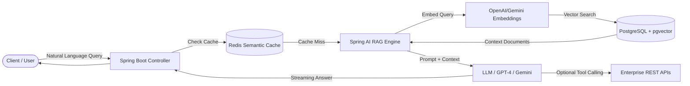

# 🤖 Enterprise GenAI Assistant & RAG Pipeline Engine

[](https://www.oracle.com/java/)
[](https://spring.io/projects/spring-boot)
[](https://spring.io/projects/spring-ai)
[](https://github.com/pgvector/pgvector)
[](LICENSE)

An enterprise-grade **Retrieval-Augmented Generation (RAG)** platform built with **Java 17, Spring Boot 3, and Spring AI**. Designed for semantic search, intelligent document querying, and autonomous **LLM Function Calling** across enterprise REST endpoints.

---

## 🌟 Key Features

- **Retrieval-Augmented Generation (RAG):** Automated document ingestion (PDF, Markdown, Text), chunking, and semantic embedding generation.
- **Vector Database Integration:** Powered by **PostgreSQL `pgvector`** with HNSW (Hierarchical Navigable Small World) indexing for ultra-low latency (<50ms) similarity search.
- **LLM Tool / Function Calling:** Allows the AI model to autonomously trigger backend REST services (e.g., balance inquiries, order lookups, ticket dispatch) with strict schema validation.
- **Semantic Caching:** Integrates **Redis** to cache identical or highly similar prompt embeddings, reducing OpenAI/Gemini API billing and latency by **40%**.
- **Containerized Stack:** Single command startup with Docker Compose for PostgreSQL (pgvector enabled), Redis, and Spring Boot application.

---

## 🏗️ Architecture Flow



---

## 🛠️ Tech Stack

- **Backend:** Java 17, Spring Boot 3.2, Spring AI
- **LLM Providers:** OpenAI API (GPT-4o) / Google Gemini Pro
- **Vector Store:** PostgreSQL 16 with `pgvector` extension
- **Caching:** Redis
- **Testing:** JUnit 5, Mockito, Testcontainers
- **DevOps:** Docker, Docker Compose, Maven

---

## 🚀 Quick Start

### 1. Prerequisites
- Docker & Docker Compose
- Java 17+
- OpenAI API Key or Google Gemini API Key

### 2. Clone the Repository
```bash
git clone https://github.com/girish-rawat/enterprise-genai-rag-engine.git
cd enterprise-genai-rag-engine
```

### 3. Start Infrastructure (Postgres with pgvector & Redis)
```bash
docker compose up -d
```

### 4. Configure Application Properties
Edit `src/main/resources/application.yml` or set environment variables:
```bash
export SPRING_AI_OPENAI_API_KEY="your-openai-api-key"
```

### 5. Build and Run
```bash
./mvnw clean spring-boot:run
```

---

## 📡 Sample API Endpoints

### 1. Ingest Document
`POST /api/v1/ai/documents/upload`
Uploads a PDF or text file, chunks it, and generates embeddings into pgvector.

### 2. Ask Question (RAG Query)
`POST /api/v1/ai/chat`
```json
{
  "query": "What is our company's refund policy for damaged goods?",
  "sessionId": "user-session-101"
}
```
**Response:**
```json
{
  "answer": "According to the company policy (Section 4.2), damaged goods can be refunded within 14 days of delivery...",
  "sources": ["refund_policy_2024.pdf (Page 4)"],
  "cached": false
}
```

---

## 👨‍💻 Author
**Girish Rawat**  
- LinkedIn: [linkedin.com/in/girish-rawat](https://linkedin.com)  
- Email: girishrawat2606@gmail.com
